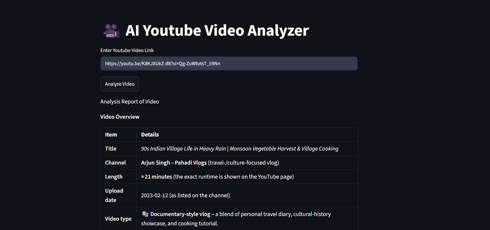

# Agentic AI YouTube Analyzer

An LLM agent that analyses a YouTube video from its link and returns a structured breakdown: a video overview, timestamped segment summaries and the main themes.

**[Live demo](https://agentic-ai-youtube-analyzer-98.streamlit.app/)**

  

## What it does

Paste a YouTube URL and the agent:

1. **Video overview:** checks the video's metadata, identifies the type of content (educational, technical, gaming, tech review, creative) and notes how it is structured.
2. **Timestamps:** builds timestamped segments in the form `[start, end, summary]`, focusing on major topic changes and key demonstrations.
3. **Organisation:** groups related segments, picks out the main themes and shows how topics progress.

The agent's instructions tell it not to invent timestamps, so the output sticks to what the transcript supports.

## How it works

| Part | Detail |
|---|---|
| Agent framework | [Agno](https://github.com/agno-agi/agno) `Agent` |
| Model | Groq-hosted LLM (`openai/gpt-oss-120b`) |
| Tool | Agno `YouTubeTools` (fetches video data and the transcript) |
| Interface | Streamlit |
| Config | `python-dotenv` loads the API key from `.env` |

`youtubeAnalizer.py` builds the agent (`build_youtube_agent()`), and `ui.py` is the Streamlit front end that sends the user's link to it.

## Run locally

```bash
git clone https://github.com/palakagrawal006/Agentic-AI-YouTube-Analyzer.git
cd Agentic-AI-YouTube-Analyzer
python -m venv .venv
source .venv/bin/activate        # Windows: .venv\Scripts\activate
pip install -r requirements.txt
```

Create a `.env` file with your Groq key (get one at [console.groq.com](https://console.groq.com)):

```
GROQ_API_KEY=your_key_here
```

Then start the app:

```bash
streamlit run ui.py
```

## Deploy on Streamlit Community Cloud

1. Push the repo to GitHub (the `.env` file is git-ignored; never commit it).
2. Create the app on [share.streamlit.io](https://share.streamlit.io) with `ui.py` as the main file.
3. In **Settings → Secrets**, add:

```toml
GROQ_API_KEY = "your_key_here"
```

## Limitations

- Only works for videos that have a transcript or captions.
- YouTube can block transcript requests from some cloud servers, so the live app may occasionally fail to fetch one.
- The analysis quality depends on the model and the transcript, and summaries can contain mistakes. Check important details against the video.

## Tech stack

Python, Agno, Groq, Streamlit, youtube-transcript-api, python-dotenv.

## Author

Built by Palak Agrawal.
